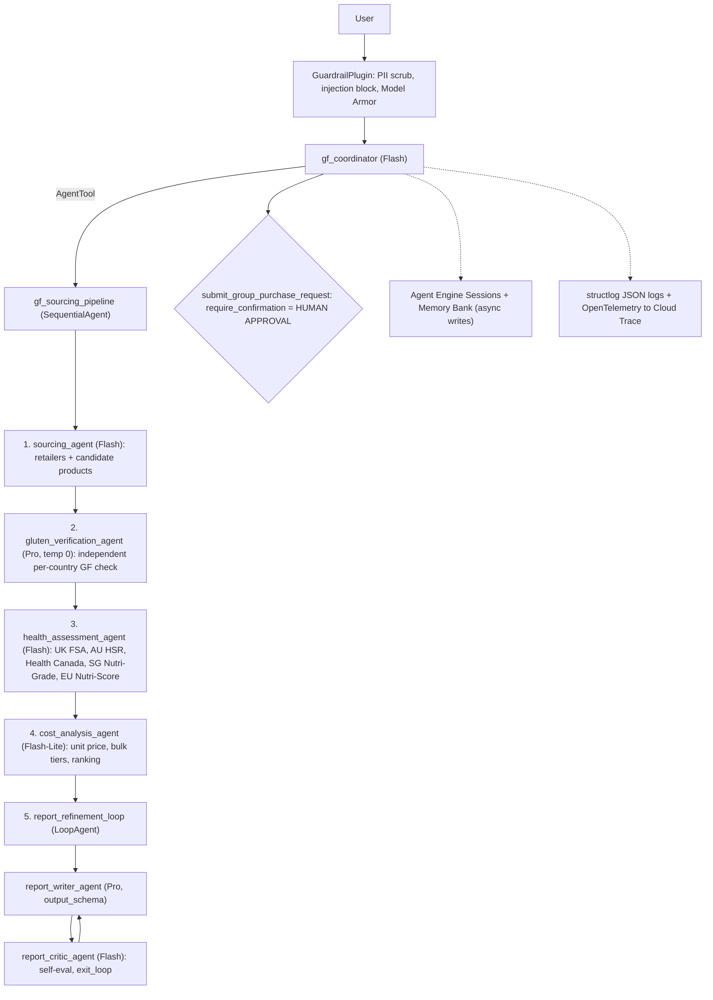

# Gluten-Free Sourcing Agent 🌾🚫

[](../../actions/workflows/ci.yml)


**A multi-agent system that finds where to buy healthy, *truly* gluten-free
food in a given country, independently checks every product's ingredients
against that country's gluten-free law, scores healthiness against cited
national standards, and ranks the most cost-effective options for group
buying. A human approves every purchase request.**

Built with Google's [Agent Development Kit (ADK)](https://google.github.io/adk-docs/)
and deployed to **Gemini Enterprise Agent Platform: Agent Runtime** (Vertex AI
Agent Engine) with Terraform, Workload Identity Federation and GitHub Actions.

> **Track:** Agents for Good (health) / Concierge &nbsp;|&nbsp; **Video:** optional walkthrough (see [docs/DEMO_SCRIPT.md](docs/DEMO_SCRIPT.md))

---

## 1. The problem

| Pain point | Why it matters |
|---|---|
| **"Gluten-free" is defined differently by country** | Australia/NZ require *no detectable gluten* and ban oats. The EU/UK allow ≤ 20 mg/kg, including gluten-free oats and Codex wheat starch. Canada allows < 20 ppm but not wheat starch. A product that is legally GF in London can be unsafe to label GF in Sydney. |
| **Ingredient checks are slow and error-prone** | Barley malt extract, unspecified "starch", soy sauce and "may contain" warnings are easy to miss. Mistakes harm people with coeliac disease. |
| **GF is not automatically healthy or affordable** | GF products are often higher in sugar, fat and salt, and they cost more. Groups can save through bulk buying, but comparing options by hand is tedious. |

## 2. The solution



Each specialist is **independent**: it re-derives its judgement with its own
deterministic tools instead of trusting the previous agent. Anything uncertain
becomes `NEEDS_CLARIFICATION`, and the coordinator asks the user rather than
guessing.

---

## 3. Rubric → code evidence (AgentOps Code Review Matrix)

| # | Criterion | Where to look |
|---|---|---|
| 1 | **Comprehensive tool docstrings** | Every tool in [`gf_agent/tools/`](gf_agent/tools/) has purpose, `Args:` (every parameter) and `Returns:`. Enforced by [`tests/unit/test_tool_interface_quality.py`](tests/unit/test_tool_interface_quality.py). |
| 2 | **Descriptive naming** | `check_ingredients_for_gluten_sources`, `find_gluten_free_retailers_by_country`, `assess_nutrition_against_national_standard`, `rank_products_by_cost_effectiveness`, `submit_group_purchase_request`. Verb-object naming is enforced by a test. |
| 3 | **Explicit JSON schemas** | [`gf_agent/schemas.py`](gf_agent/schemas.py): Pydantic models with `extra="forbid"`, enums (`Literal`), bounds. ADK turns them into strict function-declaration JSON schemas. `FinalReport` is the writer's `output_schema`. |
| 4 | **Guided error handling** | [`gf_agent/tools/_errors.py`](gf_agent/tools/_errors.py): the `@guided_errors` decorator and `GuidedToolError` return `{error_code, message, recovery_hint}` and never crash. `AuditPlugin.on_tool_error_callback` adds a second safety net. |
| 5 | **Robust system instructions** | [`gf_agent/prompts.py`](gf_agent/prompts.py): a shared `CONSTITUTION` (persona, domain knowledge, 9 non-negotiable constraints) plus role-specific instructions for each agent. |
| 6 | **History compaction** | [`gf_agent/agent.py`](gf_agent/agent.py) `App(events_compaction_config=EventsCompactionConfig(...))`: sliding-window and token-threshold summarisation with `LlmEventSummarizer` on the lite model, plus `ContextCacheConfig`. |
| 7 | **Persistent session state** | [`gf_agent/services.py`](gf_agent/services.py): `VertexAiSessionService` and `VertexAiMemoryBankService` (Agent Engine), with a durable SQLite `DatabaseSessionService` fallback. `user:` state keys persist preferences across sessions. |
| 8 | **Async memory operations** | [`gf_agent/memory.py`](gf_agent/memory.py) `AsyncMemoryPlugin.after_run_callback` schedules `asyncio.create_task(memory_service.add_events_to_memory(...))` in the background. It is incremental (only this turn's events), top-level only (no nested pipeline dumps), PII-redacted, and drained on `close()`. Tests prove it is non-blocking and incremental. |
| 9 | **Multi-agent patterns** | [`gf_agent/agent.py`](gf_agent/agent.py): a Coordinator (`LlmAgent` + `AgentTool`), a `SequentialAgent` pipeline, a `LoopAgent` generator/critic, and a deterministic `ReportPublisherAgent` ([`report_publisher.py`](gf_agent/report_publisher.py)) that returns the validated report to the coordinator. |
| 10 | **Strategic model routing** | Static: [`gf_agent/config.py`](gf_agent/config.py) `ModelRouting` + `ROLE_TO_TIER` (Pro for safety-critical gluten judgement and synthesis, Flash for dialogue/tools, Flash-Lite for arithmetic and compaction). Per request: [`gf_agent/plugins/routing.py`](gf_agent/plugins/routing.py) escalates complex multi-country or long requests to Pro and logs every `model_route` decision with its reason. |
| 11 | **Guardrails & policy plugins** | [`gf_agent/plugins/guardrails.py`](gf_agent/plugins/guardrails.py) ADK `BasePlugin`: direct injection/jailbreak/HITL-bypass blocking on the user turn, Google Cloud **Model Armor** (off-loop, configurable fail-closed), blocking of poisoned tool arguments, **quarantine of poisoned tool results** (indirect injection), and PII output scrubbing. The **self-eval** `report_critic_agent` loop sits on top. A red-team set includes false-positive checks. |
| 12 | **Human-in-the-loop hooks** | [`gf_agent/tools/actions.py`](gf_agent/tools/actions.py) `FunctionTool(submit_group_purchase_request, require_confirmation=True)`. An end-to-end test proves nothing happens until a human approves: [`tests/security/test_hitl.py`](tests/security/test_hitl.py). Deploys also need GitHub Environment approval. |
| 13 | **Structured JSON logging** | [`gf_agent/observability/logging.py`](gf_agent/observability/logging.py): `structlog` JSON with Cloud Logging `severity`, `logging.googleapis.com/trace` and `spanId` correlation. Stdlib/ADK library logs are routed through the same JSON + PII-redaction pipeline (`ProcessorFormatter`). |
| 14 | **Intent vs outcome capture** | [`gf_agent/plugins/audit.py`](gf_agent/plugins/audit.py): `tool_intent` (before) and `tool_outcome` (after, with status/error_code/duration; HITL pauses logged as `PENDING_HUMAN_APPROVAL` / `REJECTED_BY_HUMAN`). The same pairing exists for agents and models (model name, token usage). It runs first in the plugin chain, so blocked calls are still audited. |
| 15 | **Distributed tracing** | ADK OpenTelemetry spans exported to **Cloud Trace** (`adk deploy agent_engine --otel_to_cloud`; locally via [`gf_agent/observability/tracing.py`](gf_agent/observability/tracing.py)). Custom child spans cover guardrails, PII scrubbing and memory writes. |
| 16 | **PII redaction** | [`gf_agent/observability/pii.py`](gf_agent/observability/pii.py): **Cloud DLP** de-identification plus an always-on regex scrubber, applied **before** session/memory storage, in every log record and on model output. User IDs are HMAC-pseudonymised with a salt from Secret Manager. Message content capture in spans is disabled. |
| 17 | **Automated evaluation suites** | Golden dataset [`tests/golden/gluten_golden.json`](tests/golden/gluten_golden.json) (49 cases); ADK eval set [`tests/eval/gf_agent.evalset.json`](tests/eval/gf_agent.evalset.json) with tool-trajectory, LLM-judged response-match and LLM-judged safety/quality rubric metrics in [`tests/eval/test_config.json`](tests/eval/test_config.json); red-team set; all run in CI ([`.github/workflows/ci.yml`](.github/workflows/ci.yml)). |
| 18 | **Infrastructure as Code** | **Agents CLI** manifest ([`agents-cli-manifest.yaml`](agents-cli-manifest.yaml), usage in §4) plus [`infra/terraform/`](infra/terraform/): APIs, three least-privilege service accounts (CI uses a predict-only custom role), Workload Identity Federation bound to exact GitHub OIDC subjects, Secret Manager, data-access audit logs, GCS state backend, provider lock file. Bootstrap with approval gates: [`scripts/bootstrap_argolis.sh`](scripts/bootstrap_argolis.sh). Deploy uses the ADK CLI (`adk deploy agent_engine`) in a gated workflow ([`deploy.yml`](.github/workflows/deploy.yml)). |
| 19 | **Secure secret management** | No keys in code or CI. [`gf_agent/config.py`](gf_agent/config.py) `get_secret()` reads Secret Manager with ADC. The secret value is created out-of-band (never in Terraform state). GitHub Actions uses **WIF** (no JSON keys). Gitleaks runs in pre-commit and CI, and [`tests/security/test_no_hardcoded_secrets.py`](tests/security/test_no_hardcoded_secrets.py) checks the repo. |

Full write-ups: [docs/ARCHITECTURE.md](docs/ARCHITECTURE.md) · [docs/SECURITY.md](docs/SECURITY.md) · [docs/EVALUATION.md](docs/EVALUATION.md) · [docs/SETUP_GUIDE.md](docs/SETUP_GUIDE.md)

---

## 4. Quick start

### Run the tests (no cloud needed)
```bash
python -m venv .venv && source .venv/bin/activate
pip install -e ".[dev]"
pytest -q            # 190+ offline tests: golden dataset, guardrails, PII, HITL, wiring
```

### Talk to the agent locally (needs a Google Cloud project with Vertex AI)
```bash
cp .env.example gf_agent/.env     # set GOOGLE_CLOUD_PROJECT; no secrets in this file
gcloud auth application-default login
adk web                           # open the UI, pick gf_agent
```
Try: *"We are 6 households in Melbourne, Australia. Find healthy gluten-free
pasta and bread with the best group-buy value, budget 20 AUD each."* Then ask it
to prepare the group order, and approve or reject the confirmation prompt.

### Using the Agents CLI (`google-agents-cli`)
The repo includes an [`agents-cli-manifest.yaml`](agents-cli-manifest.yaml), so the course toolchain works directly on it:
```bash
pip install google-agents-cli
agents-cli info                                   # shows project, root agent, deployment target
agents-cli lint                                   # code quality checks
agents-cli playground                             # local playground UI
agents-cli run "UK: is a cereal with barley malt extract gluten free?"
agents-cli deploy --project <PROJECT_ID> --region us-central1   # deploys to Agent Runtime
```
CI/CD uses the equivalent ADK CLI command (`adk deploy agent_engine`) behind a human approval gate.

### Provision and deploy (Argolis / any GCP project)
```bash
./scripts/bootstrap_argolis.sh <PROJECT_ID> <github-owner/repo>   # Terraform with approval gates
# then GitHub → Actions → "Deploy to Agent Runtime" → Run → reviewer approves
```
Step-by-step guide for non-developers: **[docs/SETUP_GUIDE.md](docs/SETUP_GUIDE.md)**.

---

## 5. Repository layout
```
gf_agent/                 ADK app (exposes `app` and `root_agent`)
  agent.py                agent topology, App, compaction, plugins
  config.py               model routing + Secret Manager access
  schemas.py              Pydantic I/O schemas
  prompts.py              constitution + per-agent instructions
  knowledge.py            cited GF laws + nutrition thresholds
  tools/                  sourcing, verification, health, cost, actions (HITL)
  plugins/                guardrails (security), audit (intent/outcome)
  observability/          structlog JSON, OpenTelemetry, PII redaction
  memory.py services.py   async Memory Bank writes, persistent sessions
  data/                   illustrative retailers + synthetic products
tests/                    unit, security, integration, golden, eval, redteam
infra/terraform/          IaC (least-privilege IAM, WIF, Secret Manager)
.github/workflows/        CI (tests, gitleaks, terraform, live evals) + gated deploy
scripts/                  bootstrap, eval-set builder, smoke test
docs/                     spec, architecture, security, evaluation, setup, demo script
```

## 6. Important notices
- **Not medical advice.** Always read the physical label and consult a
  healthcare professional or your national coeliac society.
- **Sample data.** Retailer names are real public chains, used for realism
  only (no affiliation). All products, brands, prices and nutrition values are
  **synthetic**.
- Regulatory summaries are simplified for an educational project. Citations
  link to the official sources.

## License
Apache 2.0. See [LICENSE](LICENSE).
