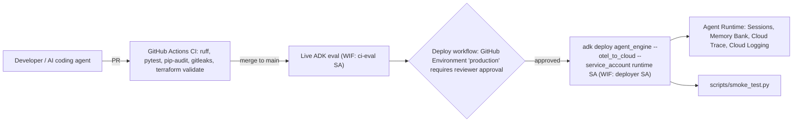

# Architecture

## Agent topology

| Agent | Type | Model tier | Tools | Writes state |
|---|---|---|---|---|
| `gf_coordinator` | `LlmAgent` (root) | fast | `preload_memory`, `record_shopping_requirements`, `check_ingredients_for_gluten_sources`, `lookup_product_label_by_barcode`, `gf_sourcing_pipeline` (AgentTool), `calculate_group_purchase_options`, `submit_group_purchase_request` (HITL) | `shopping_requirements`, `user:preferred_country`, `group_purchase_drafts` |
| `gf_sourcing_pipeline` | `SequentialAgent` | n/a | runs 5 steps below | n/a |
| `sourcing_agent` | `LlmAgent` | fast | `find_gluten_free_retailers_by_country`, `list_gluten_free_products_by_category`, optional `live_retailer_search_agent` (Google Search) | `sourcing_findings` |
| `gluten_verification_agent` | `LlmAgent`, temperature 0 | **pro** | `check_ingredients_for_gluten_sources`, `lookup_product_label_by_barcode` | `gluten_verdicts` |
| `health_assessment_agent` | `LlmAgent`, temperature 0 | fast | `assess_nutrition_against_national_standard` | `health_assessments` |
| `cost_analysis_agent` | `LlmAgent`, temperature 0 | lite | `rank_products_by_cost_effectiveness`, `calculate_group_purchase_options` | `cost_ranking` |
| `report_refinement_loop` | `LoopAgent` (max 3) | n/a | writer and critic | n/a |
| `report_writer_agent` | `LlmAgent` + `output_schema=FinalReport` | **pro** | none | `final_report` |
| `report_critic_agent` | `LlmAgent` | fast | `exit_loop` | `report_critique` (reset at each loop start) |
| `report_publisher` | custom `BaseAgent` (no LLM) | n/a | none | returns `final_report` as the pipeline result |

### Why this pattern
- **Coordinator + AgentTool**: the coordinator keeps control of the
  conversation (clarifying questions, HITL approvals). The pipeline is invoked
  as a tool and returns one result.
- **Sequential**: each step depends on the previous one (you can't price an
  unverified product).
- **Independence**: verification, health and cost agents never trust upstream
  claims. Each re-computes with deterministic tools, so the LLM cannot invent
  a price or a GF status.
- **Loop (generator/critic)**: a self-evaluation guardrail. The critic checks
  a 7-point safety and completeness checklist and calls `exit_loop` only when
  every check passes.

> ADK 2.x marks `SequentialAgent`/`LoopAgent` as superseded by `Workflow`,
> but a `Workflow` cannot yet be used under an `LlmAgent`. The classic agents
> are fully supported and are pinned via `google-adk>=2.15,<3`.

## Model routing
Defined in `gf_agent/config.py` (`ModelRouting`, `ROLE_TO_TIER`) and
overridable via `GF_MODEL_LITE/FAST/PRO`.

| Tier | Default | Used for | Rationale |
|---|---|---|---|
| lite | `gemini-3.5-flash-lite` | cost analysis, history compaction summaries | Tools do the arithmetic; cheapest and fastest |
| fast | `gemini-3.5-flash` | coordinator, sourcing, health, critic, live search | Good tool calling and dialogue at low latency |
| pro | `gemini-3.1-pro-preview` | gluten verification, report synthesis | Safety-critical judgement and long-context synthesis; a false negative can harm a coeliac |

**Per-request routing:** `ModelRoutingPlugin` (`gf_agent/plugins/routing.py`)
escalates the coordinator to the pro model for multi-country comparisons or
very long briefs (`config.choose_model_for_request`). Every decision is logged
as `model_route` with `configured_model`, `routed_model` and `reason`.

Model calls are pinned to the `global` location via `config.gemini()` (`client_kwargs`), while Agent Runtime, Sessions, Memory Bank and logs remain in `us-central1`.

## Context and memory
| Concern | Mechanism |
|---|---|
| Constitution | `prompts.CONSTITUTION` is prepended to every agent instruction |
| Short-term state | `output_key` per specialist; `{key?}` templating injects state into downstream prompts |
| Persistence | Agent Engine Sessions (`VertexAiSessionService`), or SQLite `DatabaseSessionService` locally |
| Long-term memory | Agent Engine **Memory Bank** (`VertexAiMemoryBankService`), recalled via `PreloadMemoryTool` |
| Async memory | `AsyncMemoryPlugin` schedules `add_session_to_memory` as a background task after each run |
| Compaction | `EventsCompactionConfig`: every 4 user turns (overlap 1), **or** when the prompt exceeds 60k tokens (keep last 10 events). Summaries use the lite model |
| Caching | `ContextCacheConfig(min_tokens=4096, ttl_seconds=1800)` reuses the large static constitution |

## Observability
- **Logs**: `structlog` JSON to stdout, ingested by Cloud Logging as `jsonPayload`
  with `severity`, `logging.googleapis.com/trace` and `spanId`.
- **Intent → outcome**: `agent_intent/agent_outcome`, `model_intent/model_outcome`,
  `tool_intent/tool_outcome` (status, error_code, duration_ms).
- **Traces**: ADK OpenTelemetry spans (`invocation` → `agent_run` → `call_llm` /
  `execute_tool`) exported to Cloud Trace, plus custom spans
  `guardrail.input_check`, `guardrail.pii_scrub_user_message`,
  `memory.add_session_to_memory`.

## Deployment

